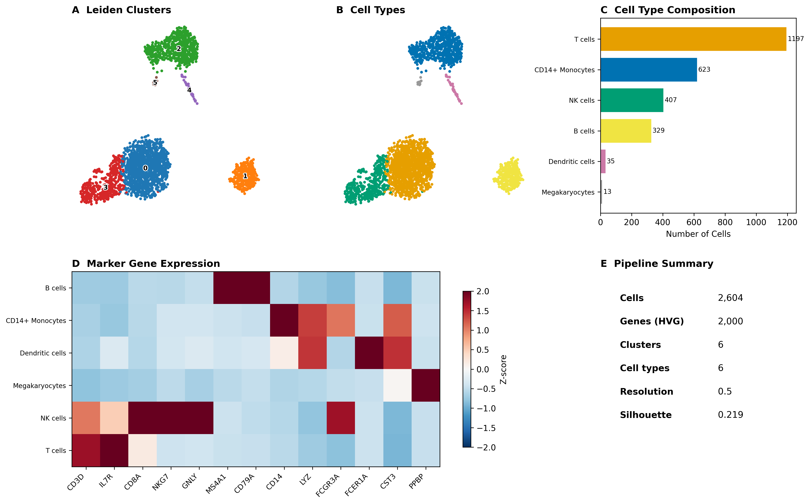
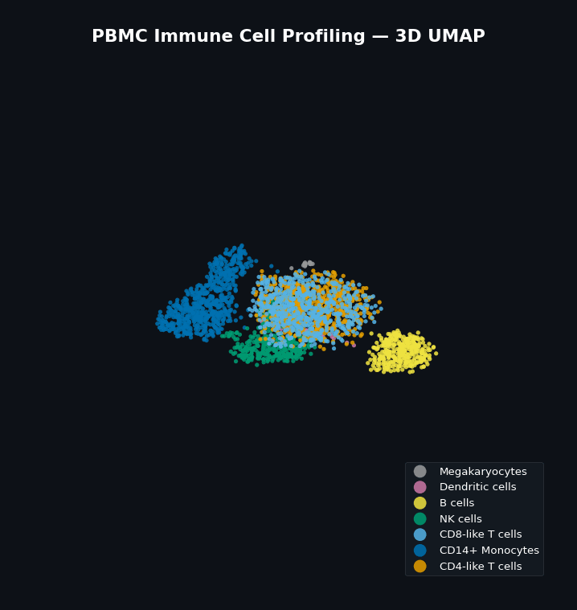

<h1 align="center">Single-cell immune profiling</h1>

<p align="center">
  <strong>From individual blood cells to immune-cell identities.<br>
  A reproducible workflow with explicit marker evidence.</strong>
</p>

<p align="center">
  A Python/Scanpy analysis of <a href="https://www.10xgenomics.com/datasets/3-k-pbm-cs-from-a-healthy-donor-1-standard-1-1-0">10x Genomics PBMC 3k</a>:
  2,700 blood cells from one healthy donor.
</p>

<p align="center">
  <a href="https://www.python.org/"></a>
  <a href="https://github.com/Ekin-Kahraman/single-cell-rnaseq-immune-profiling/actions/workflows/ci.yml"></a>
  <a href="LICENSE"></a>
</p>

<table>
  <tr>
    <td valign="top">Output</td>
    <td><strong>2,604 retained cells · six candidate immune populations</strong><br>
      The reference run identifies T cells, monocytes, NK cells, B cells, dendritic cells and a small megakaryocyte/platelet-like group.</td>
  </tr>
  <tr>
    <td valign="top">Refinement</td>
    <td><strong>A coarse T-cell label separated into candidate CD4/CD8 groups</strong><br>
      Marker scoring assigns 638 CD4-like and 559 CD8-like cells within the 1,197-cell T-cell compartment. These are computational labels.</td>
  </tr>
  <tr>
    <td valign="top">Engineering</td>
    <td><strong>Pinned installation, checked outputs and recorded runs</strong><br>
      A nine-stage workflow with explicit failure states, validated result tables, output checksums and software/input provenance.</td>
  </tr>
</table>

<p align="center">
  <a href="#results">Findings</a> ·
  <a href="#what-this-project-adds">Contribution</a> ·
  <a href="#quick-start">Run the analysis</a> ·
  <a href="#methods">Methods</a>
</p>

## Results

**T cells form the largest population; targeted analysis separates candidate
CD4-like and CD8-like groups within it.** The broader analysis also identifies
monocytes, NK cells, B cells, dendritic cells and a 13-cell candidate
megakaryocyte/platelet-like population.

<p align="center">
  
</p>

The figure combines Leiden clusters, assigned cell types, their proportions and
canonical marker expression. The labels reflect a marker-based analysis of a
standard benchmark dataset, rather than new biological discoveries or an
independent measurement of cell identity.

[Reference results](docs/reference_results.json) ·
[Cell counts](docs/cell_type_composition.csv) ·
[Reproduction record](docs/verification.md)

<details>
<summary><strong>Population counts and marker evidence</strong></summary>

| Candidate population | Cells | Representative markers |
| --- | ---: | --- |
| T cells (initial coarse CD4 label) | 1,197 | CD3D, CD3E, IL7R |
| CD14+ monocytes | 623 | CD14, LYZ |
| NK cells | 407 | NKG7, GNLY |
| B cells | 329 | MS4A1, CD79A |
| Dendritic cells | 35 | FCER1A, CST3 |
| Megakaryocyte/platelet-like | 13 | PPBP, PF4 |

Of 2,700 input cells, 2,604 remain after QC and doublet filtering. Scrublet flags
36 candidate doublets, of which 34 survive the other QC filters and are then
removed. The reference run selects Leiden resolution 0.5 with six clusters and
a silhouette score of 0.219.

The 1,197-cell T-cell compartment is scored using IL7R/CD4/TCF7/LEF1 and
CD8A/CD8B/GZMK/GZMA. This assigns **638 CD4-like cells (53.3%)** and
**559 CD8-like cells (46.7%)**. These proportions depend on the scoring procedure
and are not independently measured CD4/CD8 ratios.

</details>

<details>
<summary>Explore the cell groups in 3D</summary>

<p align="center">
  
</p>

This is a separate three-dimensional UMAP of the same annotated cells. Embedding
positions and distances are exploratory visual summaries, not physical locations.

</details>

## What this project adds

This project turns a familiar benchmark into a complete, inspectable analysis:
QC, resolution selection, marker-based annotation, targeted T-cell analysis and
figures generated through one runner.

| Area | Implementation | Useful output |
| --- | --- | --- |
| **Cell quality** | Combine expression/mitochondrial filters with seeded doublet detection. | A documented set of retained cells. |
| **Annotation** | Compare five clustering resolutions, then score explicit PBMC marker signatures. | Reviewable labels and gene-level marker evidence. |
| **T-cell refinement** | Include both CD4- and CD8-labelled parent groups; reject absent marker evidence. | Candidate subtype labels without silently dropping a resolved CD8 group. |
| **Reliable execution** | Validate resume steps and record failures; size PCA to the available data. | Actionable errors and an honest record of which stages ran. |
| **Reproducibility** | Pin the full reference environment; validate per-label counts and file checksums; record package versions, code revision and input checksum. | Results another reviewer can rerun and inspect. |

[Pipeline runner](run_pipeline.py) · [Annotation](scripts/05_annotate_cell_types.py) ·
[T-cell refinement](scripts/07_t_cell_subclustering.py) · [Regression tests](tests/test_pipeline_contracts.py)

## Quick start

Use **Python 3.12** for the pinned reference environment:

```sh
git clone https://github.com/Ekin-Kahraman/single-cell-rnaseq-immune-profiling.git
cd single-cell-rnaseq-immune-profiling
python3.12 -m venv .venv
source .venv/bin/activate
python -m pip install -r requirements-lock.txt
python -m pip install --no-deps -e .
python run_pipeline.py
python scripts/validate_outputs.py
```

On Windows, activate the environment with `.venv\Scripts\activate`.

**Input:** the public PBMC 3k expression matrix, downloaded automatically on the
first run and cached under `data/`.<br>
**Output:** annotated `.h5ad` objects, marker tables, population counts, PNG/PDF
figures, a SHA-256 manifest and `results/run_metadata.json`.

To resume after a successful preceding stage:

```sh
python run_pipeline.py --from 6
```

The runner records the selected start step and the stages actually executed.
It stops at the first failed stage. The raw `.h5ad` input checksum, installed
versions, platform, Git revision and working-tree status are recorded with the run.

## Verification

```sh
pytest -v
ruff check run_pipeline.py scripts/ tests/
python scripts/validate_outputs.py
```

Tests cover the analysis primitives and project-specific failure cases: invalid
resume requests, failed-stage handling, missing annotation evidence, retaining
both T-cell parent labels, reduced-dimensional inputs and swapped composition
counts. CI tests Python 3.10–3.12 and runs the full dataset using the pinned
Python 3.12 environment. Its analysis evidence is available as a workflow artifact.

The public figures and numbers describe the reference run in
[docs/verification.md](docs/verification.md). Fixed seeds and pinned packages
improve repeatability; numerical libraries and platforms can still affect
clustering and labels.

<details>
<summary>Reference-environment maintenance</summary>

`requirements-reference.txt` defines the core analysis versions.
`requirements-lock.txt` pins their transitive dependencies and the development/
figure-generation tools for Python 3.12. To intentionally regenerate the lockfile:

```sh
uv pip compile pyproject.toml --extra dev --extra viz --python-version 3.12 \
  --constraint requirements-reference.txt --output-file requirements-lock.txt
```

After changing versions, rerun the analysis and document changes in the public
results. To regenerate the optional 3D animation:

```sh
python scripts/make_3d_umap_gif.py
```

</details>

## Methods

**Raw cells → quality control → expression processing → clustering → marker
annotation → T-cell refinement → checked outputs.**

<details>
<summary>Analysis choices and thresholds</summary>

- **QC:** at least 200 detected genes, fewer than 2,500 detected genes and less
  than 5% mitochondrial counts per cell; genes detected in at least three cells.
  Scrublet flags likely doublets before filtering.
- **Processing:** normalise to 10,000 counts per cell, log-transform, retain
  2,000 highly variable genes, regress total counts and mitochondrial percentage,
  then scale. Log-normalised expression is retained in `adata.raw` for scoring.
- **Embedding:** 40 principal components for this dataset, a 15-neighbour graph
  and seeded UMAP. Smaller inputs use the available number of components.
- **Clustering:** Leiden resolutions 0.3, 0.5, 0.8, 1.0 and 1.2, selected by
  silhouette score among solutions with at least five clusters. This floor is
  a PBMC-specific modelling assumption.
- **Annotation:** Wilcoxon cluster-marker tests and mean signature scores from
  explicit PBMC marker sets. Markers use adjusted p-value < 0.05 and fold change > 1.5.
- **T cells:** score CD4/CD8 marker sets within all broadly annotated T cells.
- **Seeds:** UMAP, Leiden, Scrublet and silhouette sampling use `random_state=42`.
  Scanpy gene scoring uses its default seed of 0.
- **Figures:** static PNG and vector PDF outputs; a colourblind-friendly palette
  is used for the publication summary and 3D view.

</details>

<details>
<summary>Exploratory connectivity and pseudotime</summary>

PAGA summarises similarities between cell groups. Diffusion pseudotime orders
cells relative to a selected CD14+ monocyte. In a single cross-sectional sample,
this does not establish lineage, developmental direction or a monocyte-to-dendritic
transition. The root is an illustrative choice, not a progenitor designation.

</details>

<details>
<summary>Workflow and repository structure</summary>

| Stage | Script |
| --- | --- |
| Download and QC | `scripts/01_load_and_qc.py` |
| Normalisation and feature selection | `scripts/02_preprocess.py` |
| PCA, graph and UMAP | `scripts/03_reduce_dimensions.py` |
| Resolution comparison | `scripts/04_cluster.py` |
| Marker tests and annotation | `scripts/05_annotate_cell_types.py` |
| Exploratory connectivity | `scripts/06_trajectory.py` |
| T-cell refinement | `scripts/07_t_cell_subclustering.py` |
| Summary figures | `scripts/08_publication_figures.py` |
| Output checksums | `scripts/09_output_manifest.py` |

`run_pipeline.py` orchestrates the stages. Each stage reads the previous
`.h5ad` output from `results/`. `scripts/validate_outputs.py` checks the completed
outputs, and `docs/` holds the published reference figures and small result tables.
Generated datasets stay outside version control.

</details>

## Limitations

- One healthy donor is a demonstration dataset, not a basis for population or
  disease claims. Multi-donor analysis needs an appropriate study design.
- Labels are marker-based candidates. Small groups, including the 13-cell
  megakaryocyte/platelet-like cluster, need additional evidence before biological
  conclusions are drawn.
- Resolution selection and regression affect the results. Regression can remove
  biological variation as well as unwanted technical variation.
- FCGR3A+ monocytes are not separately resolved in the reference run. No pathway
  enrichment or independent assay validates the assigned cell identities.

## Data, citation and licence

**Source data:** [10x Genomics PBMC 3k](https://www.10xgenomics.com/datasets/3-k-pbm-cs-from-a-healthy-donor-1-standard-1-1-0).
The [original count matrix](https://cf.10xgenomics.com/samples/cell-exp/1.1.0/pbmc3k/pbmc3k_filtered_gene_bc_matrices.tar.gz)
is publicly available.

**Reference:** Zheng et al. (2017). *Massively parallel digital transcriptional
profiling of single cells*. [Nature Communications](https://doi.org/10.1038/ncomms14049).
[Analysis best practices](https://doi.org/10.15252/msb.20188746) ·
[Scanpy tutorial](https://scanpy-tutorials.readthedocs.io/en/latest/pbmc3k.html).

**Analysis:** Ekin Kahraman. [Citation metadata](CITATION.cff). Code is available
under the [MIT licence](LICENSE).
